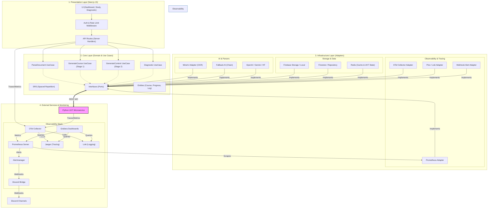

# 🏛️ Tài liệu Kiến Trúc Hệ Thống (System Architecture)

Tài liệu này mô tả cấu trúc hệ thống và luồng dữ liệu của dự án, dựa trên mô hình **Clean Architecture (Ports & Adapters)**.

---

## 1. Tổng Quan Về Kiến Trúc

Dự án được chia thành 4 lớp chính dựa trên nguyên tắc **Dependency Rule** — Mũi tên phụ thuộc chỉ được hướng từ ngoài vào trong lõi.

### 📐 Sơ đồ kiến trúc tổng thể

### Chi tiết các lớp
1.  **`core/ports/` (Interfaces)**: Định nghĩa "hình hài" của các dịch vụ. Lõi không phụ thuộc vào công nghệ cụ thể (Database, AI API).
2.  **`core/use-cases/` (Business Logic)**: Chứa luật chơi và luồng xử lý chính (Quy trình tạo khóa học, thuật toán SRS, Knowledge Tracing).
3.  **`infrastructure/adapters/` (Implementation)**: 
    - **AI Adapters**: Hỗ trợ đa dạng nhà cung cấp (OpenAI, Gemini, HuggingFace) với cơ chế **Fallback**.
    - **Persistence**: Firebase (Firestore/Storage) và Redis (cho Rate Limiting và UKT State persistence).
    - **Observability**: OpenTelemetry (distributed tracing), Prometheus (metrics), Loki (logging) và Alertmanager qua Discord Bridge.
4.  **`app/` (Presentation)**: Giao diện React (Next.js) nằm trong thư mục `web/`.

### Cập nhật gần nhất — 17/05/2026
- `answer-evaluation` đã tách sang `EvaluateAnswerUseCase` + `AnswerEvaluationAdapter`; route chỉ còn auth, validate payload, gọi use case.
- Dashboard front-end lấy dữ liệu qua `/api/dashboard` thay vì 3 request rời (`/api/progress/stats`, `/api/progress/map`, `/api/ukt/mastery`).
- Middleware API dùng chung `ApiRouteHandler` generic, giảm `any` ở route wrappers và giữ đúng tuple `ctx` cho dynamic routes.
- `GenerationProvider` có callback refresh để đồng bộ course list sau save; cache-hit path giữ đúng `isFromCache`.
- `UKT StateStore` retry `WATCH` conflict có giới hạn attempts + backoff, tránh loop vô hạn khi Redis contention.
- Env access được cô lập vào config/DI; `monitoring/bridge` validate payload bằng Pydantic trước khi gửi Discord webhook.

---

## 2. Luồng Dữ Liệu Tiêu Biểu (Data Flow)

1. **Người dùng tải PDF**:
   - Middleware kiểm tra **Rate Limit** qua Redis.
   - `ParseDocumentUseCase` gọi `MinerUAdapter` để chuyển PDF thành Markdown.
   - Kết quả được lưu vào `Firebase Storage`.

2. **Tạo Khóa Học (Course Generation)**:
   - **Stage 1 (Planner)**: `GenerateCourseUseCase` nhận Markdown, phân tích và trả về bộ khung khóa học (Outline/Chapters/Lessons).
   - **Stage 2 (Generator)**: `GenerateContentUseCase` sinh chi tiết thẻ ghi nhớ (ConceptCards) và Quiz cho tất cả các bài học **song song** (`Promise.all` kết hợp semaphore concurrency). Hỗ trợ trả về nhiều thẻ (`cards[]`) trên mỗi bài học để tách nhỏ kiến thức.
   - Cache-hit / partial-failure handling được tách ra thành helper riêng ở layer `web/lib/` để giữ workflow ổn định và test được từng nhánh.

3. **Chẩn đoán kiến thức (Diagnostic) & Mastery**:
   - `DiagnosticUseCase` sử dụng `FallbackAIAdapter` để sinh câu hỏi chẩn đoán gắn với **Knowledge Components (KC)**.
   - Kết quả làm bài được gửi sang `UKT Microservice` để tính toán trạng thái kiến thức theo 8 module y khoa (Giải phẫu, Sinh lý...).
   - Dashboard gọi `/api/ukt/mastery` để lấy dữ liệu aggregated hiển thị **Spider Chart**.
   - Redis AOF đảm bảo UKT state không bị mất khi restart container.

4. **API Wrapper & Validation**:
   - Middleware `withApiLogging`, `withApiMetrics`, `withAuth`, `withAdminAuth` dùng chung type handler generic để compose route an toàn hơn.
   - `monitoring/bridge` dùng Pydantic schema để reject malformed Alertmanager payload trước khi post sang Discord.

5. **Giám sát & Tracing**:
   - Mọi request qua Web App và UKT Service đều được instrument bằng **OpenTelemetry**.
   - Trace và Metrics được gửi về **OTel Collector**, sau đó phân phối sang **Jaeger** (tracing) và **Prometheus** (metrics).
   - Nếu có lỗi nghiêm trọng, **Alertmanager** gửi thông báo về Discord qua **Discord Bridge**.
   - DevOps theo dõi sức khỏe toàn diện qua **Grafana**.

---

## 3. Tài liệu Tham Chiếu
*   **Phân tích tài liệu**: `web/core/use-cases/parse-document.usecase.ts`
*   **Cấu hình DI**: `web/infrastructure/di/`
*   **Monitoring Config**: `monitoring/`
*   **UKT Model**: `UKT/model/ukt_model.py`

---
*Tài liệu này là một phần của quy trình quản lý BMAD. Mọi thay đổi lớn cần được thảo luận qua phiên Brainstorming.*

