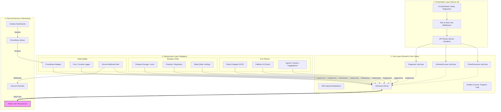

# 🏛️ Tài liệu Kiến Trúc Hệ Thống (System Architecture)

Tài liệu này mô tả cấu trúc hệ thống và luồng dữ liệu của dự án, dựa trên mô hình **Clean Architecture (Ports & Adapters)**.

---

## 1. Tổng Quan Về Kiến Trúc

Dự án được chia thành 4 lớp chính dựa trên nguyên tắc **Dependency Rule** — Mũi tên phụ thuộc chỉ được hướng từ ngoài vào trong lõi.

### 📐 Sơ đồ kiến trúc tổng thể

### Chi tiết các lớp
1.  **`core/ports/` (Interfaces)**: Định nghĩa "hình hài" của các dịch vụ. Lõi không phụ thuộc vào công nghệ cụ thể (Database, AI API).
2.  **`core/use-cases/` (Business Logic)**: Chứa luật chơi và luồng xử lý chính (Quy trình tạo khóa học, thuật toán SRS). Đây là trái tim của hệ thống.
3.  **`infrastructure/adapters/` (Implementation)**: 
    - **AI Adapters**: Hỗ trợ đa dạng nhà cung cấp (OpenAI, Gemini, HuggingFace) với cơ chế **Fallback**.
    - **Persistence**: Firebase (Firestore/Storage) và Local Storage.
    - **Observability**: Prometheus (metrics), Pino (logging) và Discord Webhooks (alerting).
4.  **`app/` (Presentation)**: Giao diện React (Next.js) và API Routes. Tuyệt đối không chứa logic tính toán phức tạp.

---

## 2. Luồng Dữ Liệu Tiêu Biểu (Data Flow)

1. **Người dùng tải PDF**:
   - Middleware kiểm tra **Rate Limit** qua Redis.
   - `ParseDocumentUseCase` gọi `MinerUAdapter` để chuyển PDF thành Markdown.
   - Kết quả được lưu vào `Firebase Storage`.

2. **Chẩn đoán kiến thức (Diagnostic)**:
   - `DiagnosticUseCase` sử dụng `FallbackAIAdapter` để sinh câu hỏi.
   - Kết quả làm bài được gửi sang `UKT Microservice` để tính toán trạng thái kiến thức.
   - Hệ thống ghi lại metrics (latency, token usage) vào `Prometheus`.

3. **Giám sát & Cảnh báo**:
   - Nếu `UKT Service` hoặc `AI Provider` gặp lỗi, `WebhookAlertAdapter` sẽ gửi cảnh báo ngay lập tức vào Discord.
   - DevOps theo dõi hiệu năng qua Dashboard trên `Grafana`.

---

## 3. Tài liệu Tham Chiếu
*   **Phân tích tài liệu**: `core/use-cases/parse-document.usecase.ts`
*   **Cấu hình DI**: `infrastructure/di/`
*   **Hệ thống lỗi**: `core/errors/`

---
*Tài liệu này là một phần của quy trình quản lý BMAD. Mọi thay đổi lớn cần được thảo luận qua phiên Brainstorming.*

