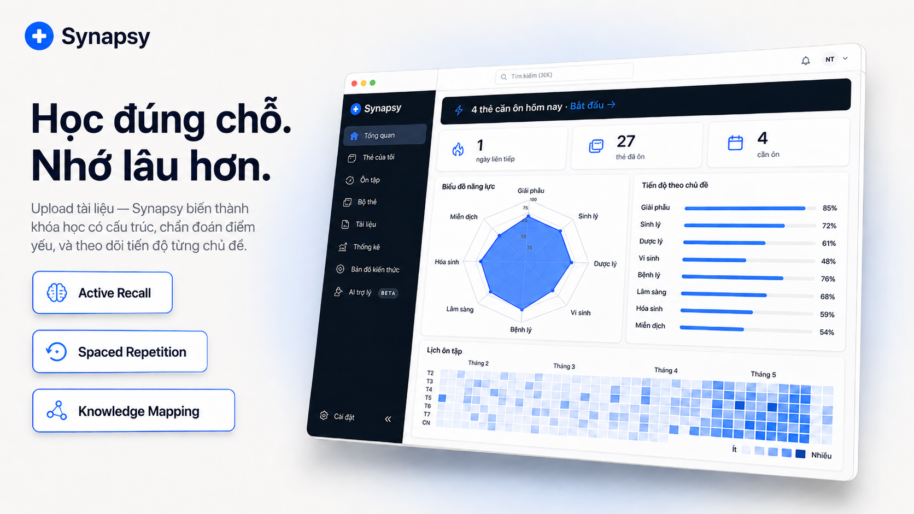

# Synapsy — Trợ lý ôn tập y khoa bằng AI


Synapsy biến tài liệu y khoa thành khóa học có cấu trúc, chẩn đoán đúng chỗ yếu, và cá nhân hóa lộ trình ôn tập cho sinh viên y khoa.

## Hạng mục bắt buộc trong repo

- [x] Source Code (FE + BE + Agent + Config): [web/app/](web/app/), [web/core/](web/core/), [web/infrastructure/](web/infrastructure/), [UKT/](UKT/), [monitoring/](monitoring/), [docker-compose.yml](docker-compose.yml), [.env.example](.env.example)
- [x] README.md ở thư mục gốc với đầy đủ link: [README.md](README.md)
- [x] Architecture Diagram: [architecture.png](architecture.png)
- [x] Weekly Journal: [JOURNAL.md](JOURNAL.md)
- [x] Worklog và phân công cụ thể: [WORKLOG.md](WORKLOG.md)

## Tài liệu quan trọng

- [Architecture Diagram](architecture.png) — sơ đồ tổng quan hệ thống.
- [ARCHITECTURE.md](ARCHITECTURE.md) — kiến trúc, layer, ports/adapters, quy tắc dependency.
- [PIPELINE.md](PIPELINE.md) — luồng PDF → parse → planner → generator → study/review.
- [Evaluation Evidence](evaluation_docs/5_Evaluation_Evidence.md) — bằng chứng đánh giá sản phẩm/kỹ thuật.
- [System Performance](evaluation_docs/system/system_performance.png) — evidence hiệu năng hệ thống.
- [AI Observability](evaluation_docs/ai/ai_observability.png) — evidence trace/metrics AI.
- [Product Trust](evaluation_docs/product/product_trust.png) — evidence UX/trust.
- [JOURNAL.md](JOURNAL.md) — nhật ký tuần của nhóm.
- [WORKLOG.md](WORKLOG.md) — task, PR history và ADR.
- [monitoring/README.md](monitoring/README.md) — hướng dẫn observability stack.
- [UKT/README.md](UKT/README.md) — User Knowledge Tracing service.
- [CONVENTIONS.md](CONVENTIONS.md) — quy chuẩn code/test/error handling.

## Tính năng chính

- Upload PDF y khoa, parse bằng MinerU Precision/VLM, giữ markdown, cấu trúc heading, bảng và ảnh nguồn khi có.
- AI Planner tạo khung chương/bài; AI Generator mở rộng thành ConceptCards nhiều thẻ cho từng lesson.
- Citation/source panel giúp truy ngược câu trả lời về đoạn nguồn trong tài liệu.
- Diagnostic quiz theo từng lesson để tìm đúng phần người học chưa chắc.
- SRS kiểu Anki với các bucket `Mới / Đang học / Đến hạn / Thuộc`, có review flow, phím tắt và thống kê theo khóa học.
- UKT (User Knowledge Tracing) gom tín hiệu diagnostic/SRS thành mastery theo module y khoa và gợi ý ưu tiên ôn tập.
- StudyMode hỗ trợ tự nhập câu trả lời ngắn, so với đáp án chuẩn, rồi mới chọn rating.
- Giao diện Synapsy v2 dùng TopBar, NavRail, DocDrawer và layout master-detail để chuyển giữa Dashboard, Thư viện và SRS.

<!-- Replace with a better screenshot or screen recording when available -->

## Công nghệ

- **Frontend**: Next.js 15, React 19, Tailwind CSS, TypeScript
- **Backend**: Next.js API routes (`web/app/api/`)
- **AI Stage 1**: Provider chain có thể cấu hình (Planner — lập outline chương/bài)
- **AI Stage 2**: Provider fallback có thể cấu hình (Generator — mở rộng outline thành ConceptCards)
- **Auth**: Firebase Auth (Google sign-in)
- **Database**: Firebase Firestore (lưu course + tiến độ SRS)
- **Storage**: Firebase Storage (PDF + layout JSON; client upload, server proxy bằng Admin SDK)
- **PDF parsing**: MinerU Precision API
- **Giám sát & Quan sát**: OpenTelemetry (Distributed Tracing), Prometheus + Grafana (Metrics), Loki (Logging), Jaeger (Tracing), Alertmanager (Cảnh báo Discord)
- **Bảo mật**: Role-Based Access Control (RBAC) qua Firebase Custom Claims
- **Tốc độ/Tiến độ**: Redis cho rate limit và trạng thái parse progress + UKT state persistence

## Bắt đầu

### 1. Clone và cài đặt

```bash
git clone <repo-url>
cd <repo>
cd web
npm install
```

### 2. Cài git hooks (bắt buộc, chạy một lần)

```bash
bash scripts/setup_hooks.sh
```

### 3. Cấu hình môi trường

```bash
cd ..
cp .env.example .env
```

Chạy lệnh copy từ repo root. Docker Compose đọc file `.env` ở root.

Khi chạy web app thủ công từ `web/`, Next.js chỉ đọc env trong `web/`. Hãy đồng bộ một bản `.env` local trước khi khởi động dev server:

```bash
cp .env web/.env
```

Trên Windows PowerShell:

```powershell
Copy-Item .env web\.env
```

Điền `.env`:

```
AI_PROVIDER=openai

OPENAI_API_KEY=
OPENAI_MODEL=gpt-4o-mini
OPENAI_PLANNER_MODEL=gpt-4o
OPENAI_GENERATOR_MODEL=gpt-4o-mini
OPENAI_DIAGNOSTIC_MODEL=gpt-4o-mini

GEMINI_API_KEY=
GEMINI_MODEL=gemini-2.0-flash

DEEPSEEK_API_KEY=
DEEPSEEK_PLANNER_MODEL=deepseek-v4-pro
DEEPSEEK_GENERATOR_MODEL=deepseek-v4-flash
DEEPSEEK_DIAGNOSTIC_MODEL=deepseek-v4-flash
DEEPSEEK_MODEL=deepseek-v4-pro

HUGGINGFACE_API_KEY=
HUGGINGFACE_MODEL=meta-llama/Llama-3.1-8B-Instruct

REDIS_URL=redis://localhost:6379
DISCORD_WEBHOOK_URL=

PDF_MINERU_BASE_URL=https://mineru.net/api/v4
PDF_MINERU_API_KEY=
# Lấy tại: mineru.net → sign up → API Management

FIREBASE_PROJECT_ID=
FIREBASE_CLIENT_EMAIL=
FIREBASE_PRIVATE_KEY=
FIREBASE_STORAGE_BUCKET=
# Lấy tại: Firebase Console → Project Settings → Service Accounts → Generate new private key

# Cấu hình UKT Service
UKT_SERVICE_URL=http://ukt-service:8000
```

Set ít nhất một AI provider key. Stage 1 đi qua provider chain trong `web/infrastructure/di/ai.di.ts`; Stage 2 fallback qua các provider đã cấu hình trong `web/lib/ai.ts`. `AI_LOG_SERVER` và `AI_LOG_API_KEY` đã được điền sẵn trong `.env.example`.

### 4. Thiết lập Firebase

Dự án dùng Firebase Auth, Storage và Firestore. Cần bật cả ba trong cùng một Firebase project.

**a) Tạo Firebase project**

Vào [Firebase Console](https://console.firebase.google.com) → Add project.

**b) Bật Google sign-in**

Firebase Console → Authentication → Sign-in method → Google → Enable.

**c) Bật Firestore**

Firebase Console → Firestore Database → Create database → choose **test mode** → select region `asia-southeast1` → Create.

> Nếu gặp lỗi "Cloud Firestore API is disabled", vào Google Cloud Console → APIs & Services → bật **Cloud Firestore API** cho project trước.

**d) Tạo Firestore composite index**

Chạy app và mở `/` một lần. Server log có thể hiện lỗi `FAILED_PRECONDITION` kèm link trực tiếp như:

```
https://console.firebase.google.com/v1/r/project/<your-project>/firestore/indexes?create_composite=...
```

Copy link đó từ terminal, mở trong browser → Firebase Console sẽ hiện form đã điền sẵn → bấm **Create index**. Chờ khoảng 1–2 phút để trạng thái đổi từ **Building** sang **Enabled**.

**e) Lấy service account credentials**

Firebase Console → Project Settings → Service Accounts → Generate new private key → download JSON → copy values into `.env`.

**f) Bật Firebase Storage + deploy rules**

Firebase Console → Storage → Get started → choose **production mode** → select the same region as Firestore.

Sau đó deploy Storage security rules (cho phép user đã đăng nhập upload browser vào `course-pdfs/` và `course-layouts/`):

```bash
firebase login          # one-time, opens browser
firebase deploy --only storage
```

> Nếu chưa cài `firebase` CLI: `npm install -g firebase-tools`

**g) Thêm Firebase env vars phía client**

Bên cạnh các biến server-side `FIREBASE_*` (từ service account), cần thêm biến cho browser. Vào Firebase Console → Project Settings → General → Your apps → Web app → SDK setup and configuration → copy các giá trị `firebaseConfig` vào `.env`:

```
NEXT_PUBLIC_FIREBASE_API_KEY=
NEXT_PUBLIC_FIREBASE_AUTH_DOMAIN=
NEXT_PUBLIC_FIREBASE_PROJECT_ID=
NEXT_PUBLIC_FIREBASE_STORAGE_BUCKET=
NEXT_PUBLIC_FIREBASE_MESSAGING_SENDER_ID=
NEXT_PUBLIC_FIREBASE_APP_ID=
```

### 5. Chạy app (khuyến nghị: Docker)

Chạy phần này từ repo root. Nếu cần refresh dependencies, chạy `npm install` trong `web/` trước.

Hệ thống hiện tại bao gồm Web App (Next.js) và UKT Microservice (Python). Cách tốt nhất để chạy toàn bộ là sử dụng Docker Compose:

```bash
# Đồng bộ lockfile trước khi build
npm install

# Khởi chạy toàn bộ hệ thống
docker-compose up --build
```

Lưu ý: thư mục output của MinerU được ghi vào `web/.mineru-output` trong container. Khi deploy/chạy Docker, cần mount volume vào `/app/.mineru-output` để tránh mất dữ liệu sau restart (đã cấu hình sẵn trong `docker-compose.yml`).

- **Web App**: http://localhost:3002 (trong Docker) hoặc http://localhost:3000 (npm run dev)
- **UKT API**: http://localhost:8000
- **Admin Monitor**: http://localhost:3002/admin/monitor (Yêu cầu quyền Admin)
- **Health Check**: http://localhost:8000/health

### 6. Chạy thủ công khi phát triển

Nếu muốn chạy riêng lẻ để phát triển:

**Web App:**
```bash
# Từ repo root:
cp .env web/.env
cd web
npm run dev
```

Nếu dùng PowerShell từ repo root, dùng `Copy-Item .env web\.env` thay cho `cp .env web/.env`.

**UKT Service:**
```bash
# Từ repo root:
cd UKT
pip install -r requirements.txt
uvicorn app.main:app --reload
```

## 🛡️ Bảo mật và phân quyền (RBAC)

Dự án sử dụng cơ chế phân quyền dựa trên **Firebase Custom Claims**.

### 1. Phân quyền (Roles)
- **`user`** (Mặc định): Có quyền tạo khóa học, học bài và quản lý dữ liệu cá nhân.
- **`admin`**: Có quyền truy cập Admin Dashboard, xem toàn bộ logs hệ thống, metrics và thông số sử dụng token AI.

### 2. Quản lý Admin
Để nâng quyền Admin cho một tài khoản, sử dụng script CLI:
```bash
# Nâng quyền cho một email
npx tsx scripts/promote-admin.ts user@example.com
```
*Lưu ý: Sau khi chạy script, người dùng cần đăng xuất và đăng nhập lại để cập nhật quyền mới.*

### 3. Bảo vệ API
Hệ thống sử dụng các middleware chuyên dụng:
- `withAuth`: Bảo vệ các API yêu cầu đăng nhập.
- `withAdminAuth`: Chặn quyền truy cập các API nhạy cảm (Logs, Usage, Metrics).
- `withApiLogging`: Tự động ghi log chi tiết mọi request và response.

## 🚀 Deploy và giám sát

### 1. Production deployment (Railway)
Dự án được thiết kế để chạy tối ưu trên **Railway**. Xem hướng dẫn chi tiết tại:
- **Web App & UKT Service**: Tự động deploy qua GitHub integration.
- **Stack giám sát**: Hướng dẫn deploy Prometheus & Grafana tại **[monitoring/README.md](monitoring/README.md)**.

### 2. Quan sát hệ thống
Hệ thống tích hợp sẵn bộ công cụ giám sát:
- **OpenTelemetry**: Thu thập trace và metrics xuyên suốt các service.
- **Prometheus**: Lưu trữ metrics từ Web và UKT.
- **Grafana**: Dashboard trực quan hóa chuyên sâu (Metrics, Logs, Traces).
- **Loki & Jaeger**: Phân tích log tập trung và truy vết luồng request (Distributed Tracing).
- **Admin Dashboard**: Giao diện quản trị trực tiếp trên Web App để theo dõi Logs và Usage.
- **Discord Alerts**: Cảnh báo lỗi hệ thống thời gian thực qua Alertmanager.

## AI logging

Prompt và tool call được tự động log khi dùng AI tool được hỗ trợ (Claude Code, Cursor, Codex, Gemini, Copilot). Sau khi chạy `setup_hooks.sh`, không cần thao tác thủ công thêm. Log nằm ở `.ai-log/session.jsonl` và được submit khi `git push`.

### 📑 Tài liệu

#### Tài liệu chính
- **[ARCHITECTURE.md](ARCHITECTURE.md)** — Bản đồ kiến trúc hệ thống và luồng dữ liệu.
- **[CLAUDE.md](CLAUDE.md)** — Hướng dẫn cho AI (Claude) về quy trình PR, git và kiến trúc.
- **[CONVENTIONS.md](CONVENTIONS.md)** — Quy chuẩn phát triển code, testing và chiến lược xử lý lỗi.
- **[JOURNAL.md](JOURNAL.md)** — Nhật ký học tập và phát triển hàng tuần của các thành viên.
- **[PIPELINE.md](PIPELINE.md)** — Bản đồ file, cấu trúc dữ liệu và chi tiết luồng AI Pipeline.
- **[WORKLOG.md](WORKLOG.md)** — Nhật ký quyết định kỹ thuật (ADRs) và phân công task.

#### 🛠️ Quản lý BMAD (Busy Madman)
Tài liệu quản lý dự án tại `_bmad-output/`:
- **[TRACK.md](_bmad-output/TRACK.md)** — Project heartbeat, theo dõi trạng thái và các bước tiếp theo.
- **[initialization_plan.md](_bmad-output/initialization_plan.md)** — Kế hoạch khởi tạo BMAD và đánh giá độ phức tạp.
- **[PRDs/](_bmad-output/PRDs/)** — Danh mục các bản đặc tả yêu cầu sản phẩm (PRD-01 đến PRD-08).
- **[reviews/](_bmad-output/reviews/)** — Các báo cáo đánh giá (Adversarial, Edge Case).
