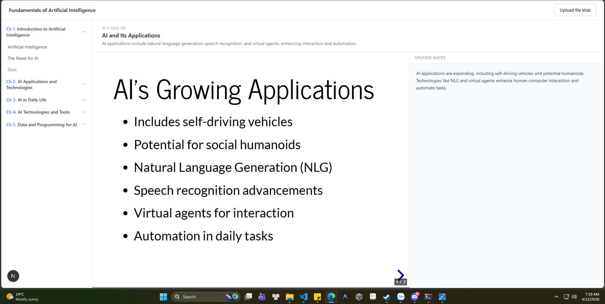

# Synapsy — AI Flashcard Course Generator

Upload a PDF, parse it to structured markdown (MinerU API), then use a two-stage AI pipeline to generate chapters, lessons, and **ConceptCard flashcards** with built-in **spaced repetition (SRS)**.

Course viewer uses a **master-detail layout**: a fixed tree nav on the left (chapters → lessons → cards inline) and a card detail pane on the right with Edit and Study tabs.


<!-- Replace with a better screenshot or screen recording when available -->

## Stack

- **Frontend**: Next.js 15, React 19, Tailwind CSS, TypeScript
- **Backend**: Next.js API routes (`app/api/`)
- **AI Stage 1**: OpenAI GPT-4o-mini (Planner — outlines chapters/lessons)
- **AI Stage 2**: OpenAI GPT-4o-mini (Generator — expands outlines into ConceptCards)
- **Auth**: Firebase Auth (Google sign-in)
- **Database**: Firebase Firestore (course + SRS progress persistence)
- **Storage**: Firebase Storage (PDF + layout JSON; client-side upload, server-side Admin proxy)
- **PDF parsing**: MinerU Precision API
- **Monitoring**: Prometheus + Grafana (latency, token usage, system health)
- **Security**: Role-Based Access Control (RBAC) via Firebase Custom Claims
- **Task Management**: Redis-backed rate limiting and job queue

## Getting Started

### 1. Clone and install

```bash
git clone <repo-url>
cd <repo>/web
npm install
```

### 2. Install git hooks (required, run once)

```bash
bash scripts/setup_hooks.sh
```

### 3. Configure environment

```bash
cp .env.example web/.env
cp .env.example UKT/.env
```

Fill in `.env`:

```
AI_PROVIDER=openai

OPENAI_API_KEY=
OPENAI_MODEL=gpt-4o-mini

GEMINI_API_KEY=
GEMINI_MODEL=gemini-2.0-flash

PDF_MINERU_BASE_URL=https://mineru.net/api/v4
PDF_MINERU_API_KEY=
# Get at: mineru.net → sign up → API Management

FIREBASE_PROJECT_ID=
FIREBASE_CLIENT_EMAIL=
FIREBASE_PRIVATE_KEY=
FIREBASE_STORAGE_BUCKET=
# Get at: Firebase Console → Project Settings → Service Accounts → Generate new private key

# UKT Service Configuration
UKT_SERVICE_URL=http://ukt-service:8000
```

Set either `OPENAI_API_KEY` or `GEMINI_API_KEY` depending on the provider you want to use. `AI_LOG_SERVER` and `AI_LOG_API_KEY` are pre-filled in `.env.example`.

### 4. Set up Firebase

This project uses Firebase Auth, Storage, and Firestore. All three must be enabled in the same Firebase project.

**a) Create a Firebase project**

Go to [Firebase Console](https://console.firebase.google.com) → Add project.

**b) Enable Google sign-in**

Firebase Console → Authentication → Sign-in method → Google → Enable.

**c) Enable Firestore**

Firebase Console → Firestore Database → Create database → choose **test mode** → select region `asia-southeast1` → Create.

> If you get a "Cloud Firestore API is disabled" error, go to Google Cloud Console → APIs & Services → Enable **Cloud Firestore API** for your project first.

**d) Create Firestore composite index**

Run the app and visit `/dashboard` once. The server log will contain a `FAILED_PRECONDITION` error with a direct link like:

```
https://console.firebase.google.com/v1/r/project/<your-project>/firestore/indexes?create_composite=...
```

Copy that link from the terminal, open it in your browser → Firebase Console will show a pre-filled form → click **Create index**. Wait ~1–2 min for status to change from **Building** to **Enabled**.

**e) Get service account credentials**

Firebase Console → Project Settings → Service Accounts → Generate new private key → download JSON → copy values into `.env`.

**f) Enable Firebase Storage + deploy rules**

Firebase Console → Storage → Get started → choose **production mode** → select the same region as Firestore.

Then deploy the Storage security rules (allows authenticated browser uploads to `course-pdfs/` and `course-layouts/`):

```bash
firebase login          # one-time, opens browser
firebase deploy --only storage
```

> If `firebase` CLI is not installed: `npm install -g firebase-tools`

**g) Add client-side Firebase env vars**

Beside the server-side `FIREBASE_*` vars (from service account), you also need browser-side vars. Go to Firebase Console → Project Settings → General → Your apps → Web app → SDK setup and configuration → copy the `firebaseConfig` values into `.env`:

```
NEXT_PUBLIC_FIREBASE_API_KEY=
NEXT_PUBLIC_FIREBASE_AUTH_DOMAIN=
NEXT_PUBLIC_FIREBASE_PROJECT_ID=
NEXT_PUBLIC_FIREBASE_STORAGE_BUCKET=
NEXT_PUBLIC_FIREBASE_MESSAGING_SENDER_ID=
NEXT_PUBLIC_FIREBASE_APP_ID=
```

### 5. Run (Recommended: Docker)

Hệ thống hiện tại bao gồm Web App (Next.js) và UKT Microservice (Python). Cách tốt nhất để chạy toàn bộ là sử dụng Docker Compose:

```bash
# Đồng bộ lockfile trước khi build
npm install

# Khởi chạy toàn bộ hệ thống
docker-compose up --build
```

- **Web App**: http://localhost:3002 (trong Docker) hoặc http://localhost:3000 (npm run dev)
- **UKT API**: http://localhost:8000
- **Admin Monitor**: http://localhost:3002/admin/monitor (Yêu cầu quyền Admin)
- **Health Check**: http://localhost:8000/health

### 6. Run (Development: Manual)

Nếu muốn chạy riêng lẻ để phát triển:

**Web App:**
```bash
cd web
npm run dev
```

**UKT Service:**
```bash
cd UKT
pip install -r requirements.txt
uvicorn app.main:app --reload
```

## 🛡️ Security & Roles (RBAC)

Dự án sử dụng cơ chế phân quyền dựa trên **Firebase Custom Claims**.

### 1. Phân quyền (Roles)
- **`user`** (Mặc định): Có quyền tạo khóa học, học bài và quản lý dữ liệu cá nhân.
- **`admin`**: Có quyền truy cập Admin Dashboard, xem toàn bộ logs hệ thống, metrics và thông số sử dụng token AI.

### 2. Quản lý Admin
Để nâng quyền Admin cho một tài khoản, sử dụng script CLI:
```bash
# Nâng quyền cho một email
npx tsx scripts/promote-admin.ts user@example.com
```
*Lưu ý: Sau khi chạy script, người dùng cần đăng xuất và đăng nhập lại để cập nhật quyền mới.*

### 3. Bảo vệ API
Hệ thống sử dụng các middleware chuyên dụng:
- `withAuth`: Bảo vệ các API yêu cầu đăng nhập.
- `withAdminAuth`: Chặn quyền truy cập các API nhạy cảm (Logs, Usage, Metrics).
- `withApiLogging`: Tự động ghi log chi tiết mọi request và response.

## 🚀 Deployment & Monitoring

### 1. Production Deployment (Railway)
Dự án được thiết kế để chạy tối ưu trên **Railway**. Xem hướng dẫn chi tiết tại:
- **Web App & UKT Service**: Tự động deploy qua GitHub integration.
- **Monitoring Stack**: Hướng dẫn deploy Prometheus & Grafana tại **[monitoring/README.md](monitoring/README.md)**.

### 2. Observability
Hệ thống tích hợp sẵn bộ công cụ giám sát:
- **Prometheus**: Thu thập metrics từ các service qua `/api/metrics` (chỉ dành cho Admin).
- **Grafana**: Dashboard trực quan hóa chuyên sâu.
- **Admin Dashboard**: Giao diện quản trị trực tiếp trên Web App để theo dõi Logs và Usage.
- **Discord Alerts**: Cảnh báo lỗi hệ thống thời gian thực.

## AI Logging

Prompts and tool calls are automatically logged when you use any supported AI tool (Claude Code, Cursor, Codex, Gemini, Copilot). No manual steps needed after running `setup_hooks.sh`. Logs go to `.ai-log/session.jsonl` and are submitted on `git push`.

### 📑 Documentation

#### Core Docs
- **[ARCHITECTURE.md](ARCHITECTURE.md)** — Bản đồ kiến trúc hệ thống và luồng dữ liệu.
- **[CLAUDE.md](CLAUDE.md)** — Hướng dẫn cho AI (Claude) về quy trình PR, git và kiến trúc.
- **[CONVENTIONS.md](CONVENTIONS.md)** — Quy chuẩn phát triển code, testing và chiến lược xử lý lỗi.
- **[JOURNAL.md](JOURNAL.md)** — Nhật ký học tập và phát triển hàng tuần của các thành viên.
- **[PIPELINE.md](PIPELINE.md)** — Bản đồ file, cấu trúc dữ liệu và chi tiết luồng AI Pipeline.
- **[WORKLOG.md](WORKLOG.md)** — Nhật ký quyết định kỹ thuật (ADRs) và phân công task.

#### 🛠️ BMAD Management (Busy Madman)
Tài liệu quản lý dự án tại `_bmad-output/`:
- **[TRACK.md](_bmad-output/TRACK.md)** — Project heartbeat, theo dõi trạng thái và các bước tiếp theo.
- **[initialization_plan.md](_bmad-output/initialization_plan.md)** — Kế hoạch khởi tạo BMAD và đánh giá độ phức tạp.
- **[PRDs/](_bmad-output/PRDs/)** — Danh mục các bản đặc tả yêu cầu sản phẩm (PRD-01 đến PRD-08).
- **[reviews/](_bmad-output/reviews/)** — Các báo cáo đánh giá (Adversarial, Edge Case).

