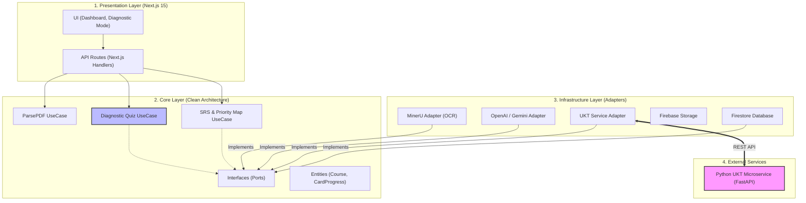

# 📐 System Architecture Visualization (Clean Architecture)

Tài liệu này cung cấp cái nhìn trực quan về cách mã nguồn của dự án **A20-App-046** được tổ chức.

## 1. Sơ đồ kiến trúc tổng thể

---

## 2. Luồng dữ liệu (Data Flow)

### A. Pipeline Chẩn đoán (Diagnostic Loop):
1. **Upload**: UI gửi PDF -> MinerU Parser trích xuất Markdown.
2. **Diagnostic**: `DiagnosticUseCase` gọi LLM để sinh 15-20 câu hỏi chẩn đoán dựa trên nội dung đã parse.
3. **UKT Inference**: Kết quả làm bài (Đúng/Sai + Độ tự tin) được gửi sang **UKT Microservice**.
4. **Priority Map**: UKT trả về trạng thái kiến thức $(\mu, \sigma)$ -> UI hiển thị bản đồ ưu tiên học tập.

### B. Pipeline Lặp lại ngắt quãng (SRS):
1. **Study**: Người dùng học thẻ bài -> Gửi đánh giá (Hard/Ok/Easy).
2. **UKT Update**: Dữ liệu gửi sang **UKT Microservice** để cập nhật trạng thái kiến thức tức thời.
3. **Schedule**: Hệ thống tính toán ngày ôn tập tiếp theo dựa trên kết quả từ UKT.

## 3. Lợi ích của kiến trúc này
- **Testability**: Có thể test toàn bộ logic nghiệp vụ (Core) mà không cần mạng hay database thực tế bằng cách dùng Mock Adapters.
- **Maintainability**: Thay đổi công nghệ ở lớp Infrastructure không ảnh hưởng đến logic ở lớp Core.
- **Teamwork**: Các thành viên có thể làm việc song song trên các Layer khác nhau mà không bị xung đột code.
