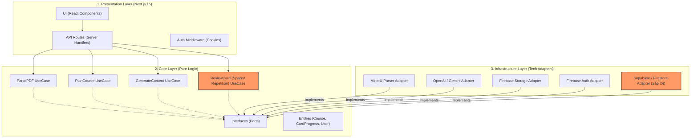

# 📐 System Architecture Visualization (Clean Architecture)

Tài liệu này cung cấp cái nhìn trực quan về cách mã nguồn của dự án **A20-App-046** được tổ chức.

## 1. Sơ đồ kiến trúc tổng thể

---

## 2. Luồng dữ liệu (Data Flow)

### A. Pipeline Tạo Bài Học:
1. **Request**: UI gửi PDF -> API Route.
2. **Logic**: UseCase điều phối:
   - Gọi **Storage Adapter** để lưu file tạm.
   - Gọi **Parser Adapter** (MinerU) để lấy dữ liệu Markdown.
   - Gọi **LLM Adapter** (Stage 1) để tạo Course Outline.
3. **Response**: Trả về dữ liệu structured cho UI.

### B. Pipeline Spaced Repetition:
1. **Request**: UI gửi đánh giá người dùng (Dễ/Khó) -> API Route.
2. **Logic**: `ReviewCardUseCase` tính toán `nextReviewDate` dựa trên thuật toán SM-2.
3. **Persistence**: Gọi **DB Adapter** để lưu trạng thái mới vào Database.

## 3. Lợi ích của kiến trúc này
- **Testability**: Có thể test toàn bộ logic nghiệp vụ (Core) mà không cần mạng hay database thực tế bằng cách dùng Mock Adapters.
- **Maintainability**: Thay đổi công nghệ ở lớp Infrastructure không ảnh hưởng đến logic ở lớp Core.
- **Teamwork**: Các thành viên có thể làm việc song song trên các Layer khác nhau mà không bị xung đột code.
