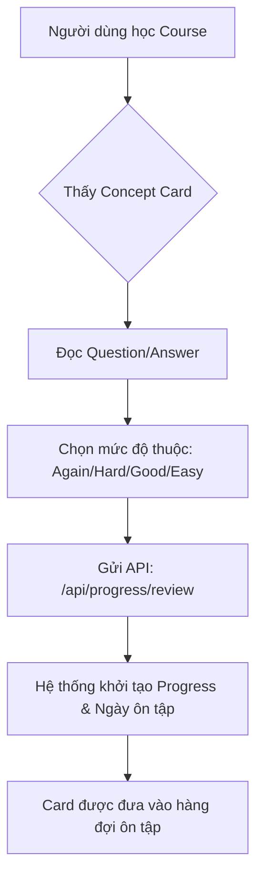
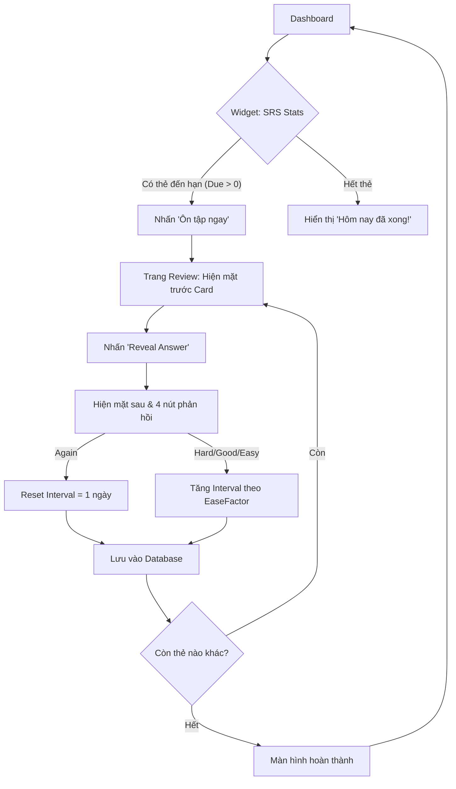
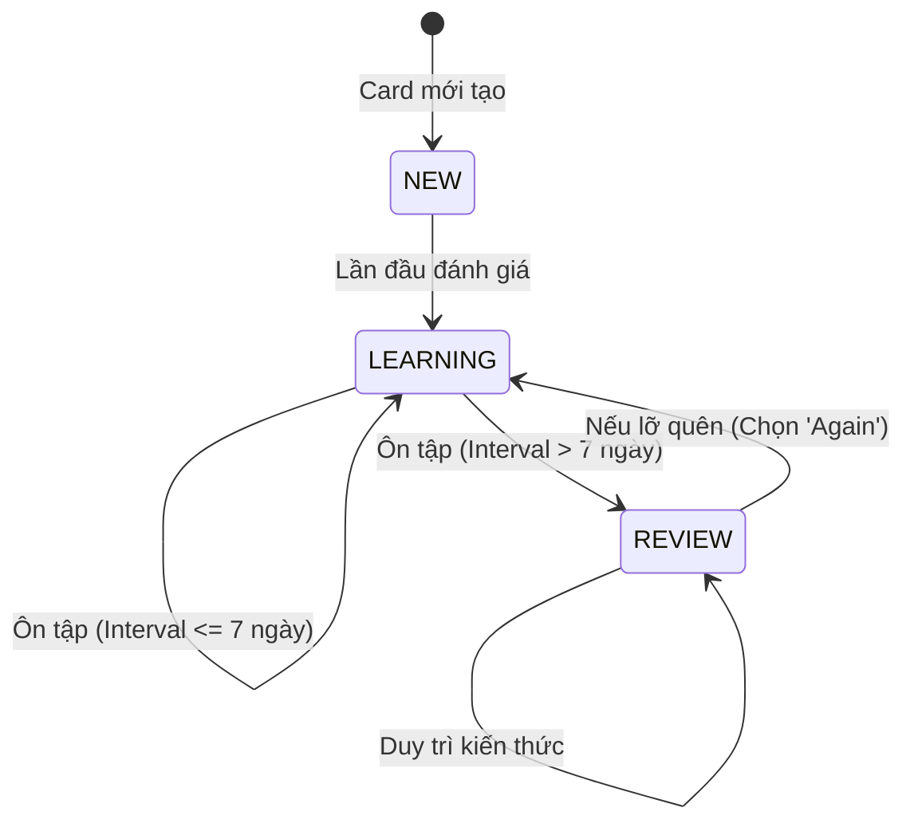

# User Flow: Spaced Repetition System (SRS)

Hệ thống Spaced Repetition giúp người dùng chuyển kiến thức từ bộ nhớ ngắn hạn sang dài hạn thông qua hai luồng chính.

## 1. Luồng Học Mới (Learning Flow)
Khi người dùng đang học một khóa học và bắt gặp các Concept Card.

## 2. Luồng Ôn Tập Hàng Ngày (Review Flow)
Khi người dùng quay lại Dashboard để duy trì kiến thức.

## 3. Trạng thái Thẻ (Card Status Transition)
Vòng đời của một thẻ trong hệ thống.

